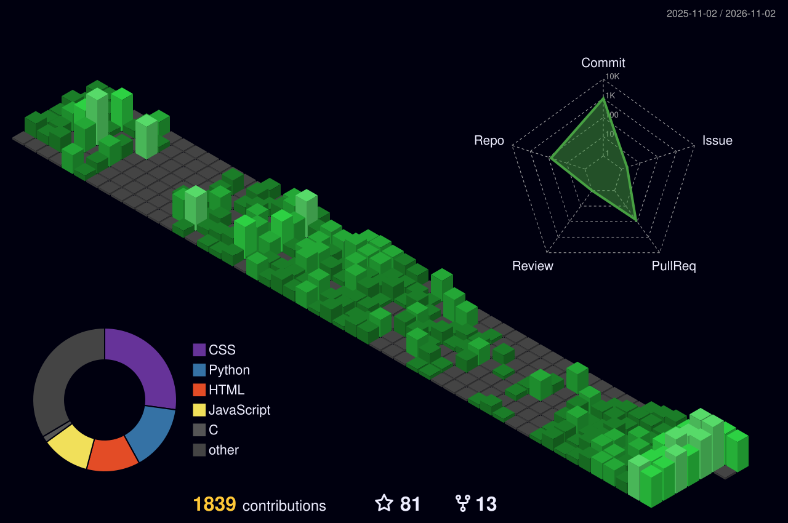

  

  

  

  

  

<h2></h2>

  

<h2></h2>

<table align="center">
  <tr>
    <td align="center"> <b>Views</b></td>
    <td align="center"> <b>Followers</b></td>
    <td align="center"> <b>Stars</b></td>
    <td align="center"> <b>Awesome</b></td>
  </tr>
  <tr>
    <td align="center">
      
    </td>
    <td align="center">
      
    </td>
    <td align="center">
      
    </td>
    <td align="center">
      
    </td>
  </tr>
</table>

  

<h2></h2>

  

<h2></h2>

  

<h2></h2>

  

  

<h2></h2>

<picture>
  <source media="(prefers-color-scheme: dark)" srcset="https://raw.githubusercontent.com/Antech-greyhat/Antech-greyhat/output/github-snake-dark.svg" />
  <source media="(prefers-color-scheme: light)" srcset="https://raw.githubusercontent.com/Antech-greyhat/Antech-greyhat/output/github-snake.svg" />
  
</picture>

  

<h2></h2>

      

  

